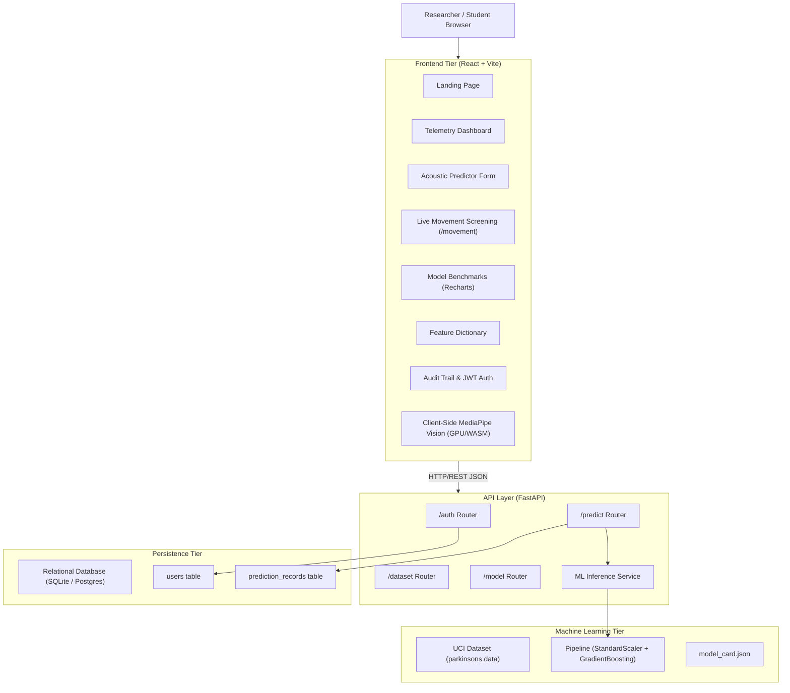

# Architecture Documentation: Parkinson's Disease ML Research & Prediction Platform

## 1. System Overview

The platform is designed around strict separation of concerns across four logical tiers:
1. **Frontend Presentation Layer** (React 18, TypeScript, Vite, Tailwind CSS)
2. **Application & API Layer** (FastAPI, Pydantic, JWT Authentication)
3. **Machine Learning Pipeline Layer** (Scikit-learn, StandardScaler, Gradient Boosting)
4. **Relational Persistence Layer** (SQLAlchemy, Alembic, SQLite / PostgreSQL ready)

## 2. Machine Learning Design & Anti-Leakage Protocol

A sustained vowel recording dataset contains repeated phonations from the same participant.
If records are split naively with `train_test_split(random_state=42)`:
- Voice timbres from the same patient are present in both training and test partitions.
- Results appear falsely high (>95% accuracy) while completely failing to generalize to unseen patients.

**Protocol Implemented**:
- Subject IDs (`phon_R01_S...`) extracted via regex from the specimen `name` column.
- `GroupShuffleSplit` assigns 24 participants (146 samples) to training, and 8 completely unseen participants (49 samples) to held-out test evaluation.
- `StratifiedGroupKFold` runs 4-fold cross-validation inside the training set.
- Champion model: **Gradient Boosting Classifier** achieving 77.6% Test Accuracy, 100% Sensitivity (Recall), 0.871 F1-score, and 0.774 ROC-AUC.

## 3. Security & Safety Boundaries
- Passwords hashed using native `bcrypt` with automatic salting.
- State-of-the-art JWT bearer tokens for prediction history isolation.
- Transparent medical safety disclaimers prominently rendered on all user-facing screens.
- Zero medical diagnostic claims made by the application.

## 4. Live Movement Screening Architecture

The Live Movement Screening module operates completely client-side in the user's browser using Google's `@mediapipe/tasks-vision` engine running over WebAssembly and WebGL/GPU:
- **Hand Landmark Tracking**: Detects 21 3D hand landmarks at up to 60 FPS for Hand Tremor stability and Finger Tapping hysteresis detection.
- **Pose Landmark Tracking**: Detects 33 whole-body landmarks for Arm Movement angular velocity/smoothness and Walking Posture trunk lean/cadence.
- **Privacy Guarantee**: All video frames are ingested and analyzed locally in client memory; no camera footage or landmark coordinates are streamed or stored remotely.
- **Scientific Integrity**: The system presents purely objective observable kinematic measurements (e.g. rhythm CV%, frequency in Hz, amplitude fatigue) and explicitly refrains from outputting unsupported automated clinical disease probabilities.

